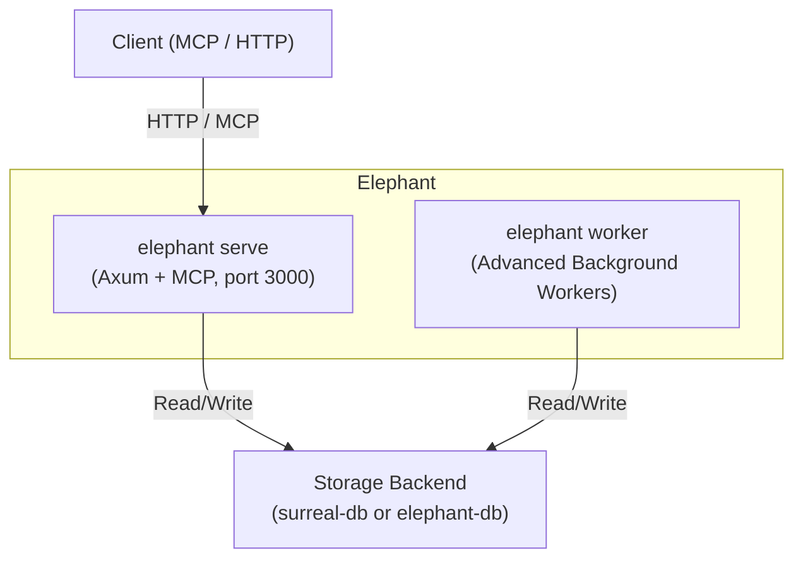
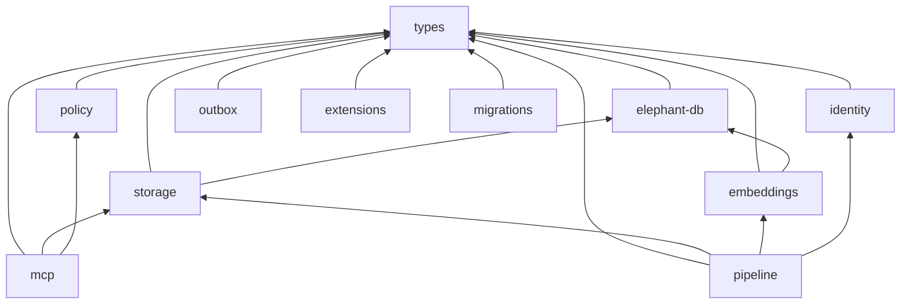

## Technology Foundations

Elephant is built on three key technologies:

**[SurrealDB](https://surrealdb.com)** is the default persistent backend. It combines document storage, graph traversals, and vector search in one engine, and Elephant's Surreal-backed path still uses the strict [SurrealDB boundary patterns](/operations/surrealdb-patterns) documented for this repo.

**`elephant-db`** is Elephant's embedded in-memory backend. It is a typed Rust kernel with graph traversal, lexical/vector search, and JSON snapshot import/export. It powers lightweight local deployments and the WASM-oriented embedded path. It is volatile unless you explicitly load/export snapshots; use SurrealDB for durable production and long-running local field tests.

**[Meerkat](https://github.com/lukacf/meerkat)** is a modular LLM agent harness built in Rust. It powers extraction, truth-maintenance adjudication, and wiki editorial model calls:

- **Extraction pipeline** - Meerkat orchestrates LLM calls for entity/relationship extraction with structured output guarantees (`OutputSchema::strict()`), automatic retries, tool access for context-aware extraction, and per-request budget enforcement. See [Extraction](/pipeline/extraction).
The MCP server uses the Rust `rmcp` transport. Current static dispatcher counts
are 23 Default, 24 Agent, 43 Maintenance, and 91 Full; runtime tools and
readiness/authorization filters affect `tools/list`. See [MCP](/mcp/overview).

## Runtime Topology

Elephant runs through one public command, `elephant`, over either `surreal-db` or embedded `elephant-db`, deployable from a single Docker Compose stack up to a horizontally scaled cluster.



### Deployment Modes

| Mode | Description |
|---|---|
| **Single-process** | `elephant serve` runs API + workers together. This is the natural embedded `elephant-db` mode and the simplest local runtime. |
| **Single-node container** | Default Docker Compose runs `elephant serve` plus a `surrealdb` container. The supplied Compose file runs managed workers; custom deployments may run `elephant worker` separately. |
| **Clustered** | `elephant serve --server-only` horizontally scaled behind a load balancer. SurrealDB cluster. `elephant worker` scaled independently. |

## Public Command Surface

Elephant ships one public binary, `elephant`, built from the Cargo workspace.

| Command | Role |
|---|---|
| `elephant serve` | HTTP API, MCP protocol handlers, ABAC enforcement, and managed workers. |
| `elephant serve --server-only` | HTTP/MCP server without managed workers. |
| `elephant worker` | Background workers for active work kinds such as `render_doc`, `plan_extraction`, `extract_assertions`, truth maintenance, freshness, and reprocessing. |
| `elephant migrate` | SurrealDB migrations. |
| `elephant snapshot export/import` | Live embedded ElephantDB snapshot operations through the running API. |
| `elephant status` | Health and runtime status. |
| `elephant demo-wiki` | Isolated in-memory Living Wiki demo. |
| `elephant data-migrate` | One-time embedded snapshot to SurrealDB migration. |

## Workspace Layout

```
elephant/
  bin/
    elephant/
    elephant-api/
    elephant-pipeline/
  crates/
    elephant/
    elephant-db/
    types/
    storage/
    policy/
    identity/
    pipeline/
    embeddings/
    mcp/
    outbox/
    extensions/
    migrations/
  tests/
    scenarios/
    e2e/
    dev_readiness/
  xtask/
```

### Crate Dependency Graph



## Crate Responsibilities

<Accordion title="types" icon="cube">
  Domain types for all records (`Entity`, `Rel`, `Attribute`, `Doc`, `Assertion`, etc.),
  the `RecordId` system with `TableName` enum covering 30+ tables,
  `Link<T>` typed foreign-key references, `BaseFields` shared across all records,
  request/response DTOs, and validation logic.
  No runtime dependencies on the database or network.
</Accordion>

<Accordion title="elephant-db" icon="database">
  Embedded in-memory graph/vector storage kernel used for lightweight local deployments,
  tests, snapshots, and the WASM-oriented path. It is not a SurrealQL replacement
  and it does not persist automatically across process restarts; configure a
  snapshot path and export before shutdown if you need continuity.
  storage dispatch keeps the embedded path behind the same repository contracts as
  the Surreal-backed path.
</Accordion>

<Accordion title="storage" icon="database">
  Backend-agnostic repository layer used by both `surreal-db` and embedded `elephant-db`.
  The Surreal path uses DB proxy structs (no `#[serde(flatten)]` at the database boundary)
  with `TryFrom` conversion to domain types. The embedded path dispatches into the typed in-memory kernel.
  Provides CRUD for every record type plus specialized query methods for search, pagination, graph traversal, snapshots, and maintenance.
</Accordion>

<Accordion title="policy" icon="shield-halved">
  Attribute-Based Access Control (ABAC) engine. Evaluates `SecurityEnvelope` labels
  on every record against the caller's clearance. Handles field-level redaction and
  subject-scoped filtering. Every API response passes through this layer.
</Accordion>

<Accordion title="identity" icon="fingerprint">
  Identity key generation and entity merge strategy. Generates stable identity keys
  from entity attributes and handles the merge workflow when two entities are
  determined to be the same real-world object, including redirect pointers and
  lineage tracking.
</Accordion>

<Accordion title="pipeline" icon="gears">
  Background workers implementing the active ingestion-to-graph path:
  **triage_source**, **ingest_metadata**, **validate_artifacts**, **commit_artifacts**,
  **upgrade_ingest_mode**, **render_doc**, **build_doc_tree**, **plan_extraction**,
  **extract_assertions**, **truth maintenance**, **freshness**, and **reprocessing**.
  Uses a durable work scheduler with lease-based execution and outbox-triggered truth maintenance.
</Accordion>

<Accordion title="embeddings" icon="vector-square">
  Vector embedding provider abstraction. Supports multiple backends including
  FastEmbed (local), OpenAI, and a fake provider for testing. Configured per-space
  via `SpaceConfig` records.
</Accordion>

<Accordion title="mcp" icon="plug">
  Model Context Protocol handlers and tool registry. Exposes Elephant operations
  as MCP tools (search, ingest, entity management, relationship CRUD, identity
  resolution, context bundles, work queue management). Maps MCP requests to
  storage and policy layers.
</Accordion>

<Accordion title="outbox" icon="envelope">
  Event outbox for reliable messaging. Writes `SystemEvent` records with monotonic
  sequence numbers. Supports cursor-based streaming for consumers that need
  at-least-once delivery of change events.
</Accordion>

<Accordion title="extensions" icon="puzzle-piece">
  Extension manifest parsing and reference handling. Manages extension contracts
  for plugins that extend Elephant's extraction and processing capabilities.
</Accordion>

<Accordion title="migrations" icon="database">
  SurrealQL migration runner. Manages schema evolution for all 30+ tables
  with versioned migration files applied by `elephant migrate`.
</Accordion>

## Build Configuration

The workspace uses Rust edition 2021 with strict lints:

| Lint | Level |
|---|---|
| `unsafe_code` | **forbid** |
| `unwrap_used`, `expect_used`, `panic`, `todo` | warn |
| Clippy `pedantic` + `nursery` | warn |

Default members (fast `cargo test`) include the lighter core crates. Heavier crates (`pipeline`, `api`, `embeddings`, `benchmarks`, `e2e`, `scenarios`) are exercised through the staged Makefile/CI lanes and the `repo-cargo` / `hook-cargo` wrappers.

<Note>
  SurrealDB integration tests use the `kv-mem` in-memory backend so they run
  without an external database process. See the [Domain Model](/architecture/domain-model)
  page for the complete record type reference.
</Note>
