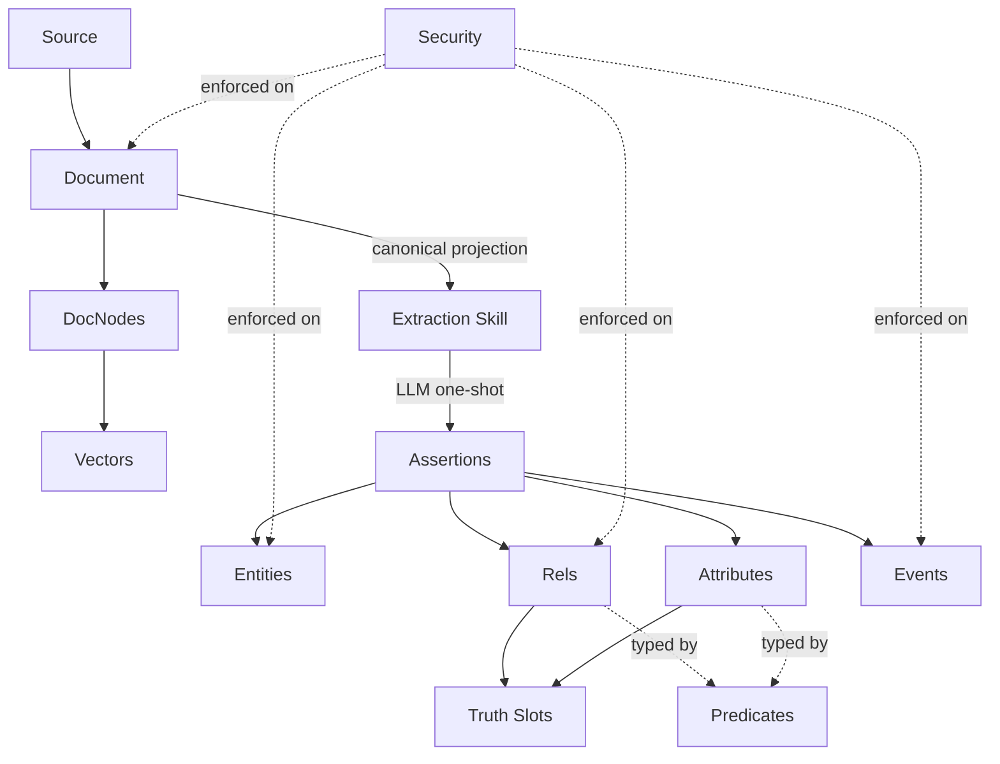

<Note>
The scenarios and output snippets below are illustrative, using fictional
people, organizations, and device data. Exact model output and timing depend
on configuration and evidence; these examples are not production acceptance
results.
</Note>

Continuing from [Part 1](/guides/putting-it-together), where we traced four source evidence examples through documents, skill routing, entities, relationships, and events. Now we follow the same examples through the evidence layer, conflict resolution, and security.

---

## Step 6: Assertions - the evidence underneath

Every entity, relationship, and event above traces back to one or more **Assertions** - the raw extracted claims with evidence spans pointing to exact character offsets in the rendered evidence projection.

<Tabs>
  <Tab title="Email">
    ```json
    {
      "subject_text": "Bob Martinez",
      "predicate_text": "met_with",
      "object_text": "Dr. Kim",
      "confidence": 0.95,
      "evidence_span": {
        "start": 52,
        "end": 108,
        "quote": "I met with Dr. Kim at City Dental yesterday"
      }
    }
    ```
    The `evidence_span` lets anyone verify the claim by looking at characters 52-108 in the rendered projection of the source email.
  </Tab>
  <Tab title="IoT">
    ```json
    {
      "subject_text": "leak_sensor_kitchen",
      "predicate_text": "detected",
      "object_literal": "water",
      "confidence": 1.0,
      "evidence_span": {
        "start": 220,
        "end": 279,
        "quote": "leak_sensor_kitchen: ALERT water detected under sink"
      }
    }
    ```
    IoT assertions often have `confidence: 1.0` - the sensor either fired or it didn't. There's no interpretation ambiguity.
  </Tab>
  <Tab title="Fiction">
    The pipeline produces hundreds of assertions across the full novel. Here's one from Chapter 6:
    ```json
    {
      "subject_text": "the Duchess",
      "predicate_text": "owns",
      "object_text": "Cheshire Cat",
      "confidence": 0.85,
      "evidence_span": {
        "start": 14209,
        "end": 14283,
        "quote": "It's a Cheshire cat, said the Duchess, and that's why."
      }
    }
    ```
    The evidence span points to a specific offset in the full 27,000-word text - `start: 14209` is deep into Chapter 6. This is why Elephant uses character offsets rather than page numbers: they're precise across any rendering of the text.
  </Tab>
  <Tab title="Codebase">
    Codebase assertions come from different file types, and their provenance is especially powerful:
    ```json
    {
      "subject_text": "elephant-api",
      "predicate_text": "depends_on",
      "object_text": "elephant-storage",
      "confidence": 1.0,
      "evidence_span": {
        "start": 892,
        "end": 941,
        "quote": "elephant-storage = { path = \"../../crates/storage\" }"
      }
    }
    ```
    This assertion has `confidence: 1.0` - a Cargo.toml dependency declaration is unambiguous, like a sensor reading. Compare with an assertion from AGENTS.md (`confidence: 0.9`) where the LLM is interpreting natural language. The provenance chain lets you ask: *"Why does Elephant think policy implements ABAC? Because AGENTS.md says so, at this exact line."*
  </Tab>
</Tabs>

<Note>
Sources and immutable evidence revisions ground extracted assertions. Canonical
graph records and truth slots preserve evidence links and are updated through
validated commits and truth maintenance. Explicit operator writes also exist;
not every graph row is produced by extraction.
</Note>

---

## Step 7: Truth Maintenance - when sources disagree

Now imagine new information arrives that conflicts with what we extracted earlier. (If the new source simply *repeats* an existing value, that is corroboration, not a conflict - the evidence merges into the existing claim. Truth maintenance only opens a conflict when the values genuinely diverge.)

<Tabs>
  <Tab title="Email">
    | Old assertion | New assertion | Policy | Result |
    |--------------|---------------|--------|--------|
    | launch date = April 1 (email 1) | launch date = April 15 (email 2) | `SupersedeByRecency` | April 1 → `superseded`, April 15 → `approved` |

    A second email says the wellness launch has been pushed to April 15. Both assertions land in the same **Truth Slot** (keyed by subject + predicate). With a configured supersession policy and supporting evidence, adjudication
    can select the newer claim and mark the older value `superseded`. The April 1 event updates its status; a new April 15 event is created. Both assertions remain - you can always query the slot history.
  </Tab>
  <Tab title="IoT">
    | Old assertion | New assertion | Policy | Result |
    |--------------|---------------|--------|--------|
    | water detected under sink | all clear, no water | `SupersedeByRecency` | leak alert → `superseded` |

    A second sensor reading conflicts with the earlier alert. The "all clear" wins, but the historical event record persists: "there was a leak at 07:15, resolved by 07:45." This is crucial for IoT - you need the incident history even after resolution.
  </Tab>
  <Tab title="Fiction">
    | Source | Claim | Policy | Result |
    |--------|-------|--------|--------|
    | Novel | Cheshire Cat trait = "grinning" | `AllowParallel` | Both survive |
    | Literary essay | Cheshire Cat trait = "represents absurdity" | `AllowParallel` | Both survive |
    | Novel | Queen role = "antagonist" | `AllowParallel` | Both survive |
    | Literary essay | Queen role = "parody of authority" | `AllowParallel` | Both survive |

    Ingesting a literary analysis essay adds new assertions about existing entities. Under `AllowParallel`, both interpretations coexist - the right policy for fiction. Business data would use `SupersedeByRecency` to pick one winner. Each assertion tracks its source.
  </Tab>
  <Tab title="Codebase">
    | Old assertion | New assertion | Policy | Result |
    |--------------|---------------|--------|--------|
    | elephant-pipeline `depends_on` elephant-storage (Jan Cargo.toml) | no direct dependency (Feb Cargo.toml) | `SupersedeByRecency` | old dep → `superseded`, `valid_to: 2026-02-06` |

    Re-ingesting after a refactor produces competing assertions. The old dependency becomes historical - you can query "What did elephant-pipeline depend on in January?" and get the old answer with full provenance. The graph records **how the architecture evolved**, traced to specific commits.
  </Tab>
</Tabs>

<Note>
When `ANTHROPIC_API_KEY` is set, these decisions are made by an LLM adjudicator that sees the actual claim values - it can extract validity dates from the text itself ("pushed to April 15") rather than relying on ingest timestamps. The named policies apply as the deterministic fallback for keyless deployments, and as the semantics the adjudicator learns and records per predicate.
</Note>

---

## Step 8: Security - who sees what

All of the above is scoped by [spaces and security](/concepts/security). Each record carries a **SecurityEnvelope** controlling visibility.

<Tabs>
  <Tab title="Email">
    | Property | Value |
    |----------|-------|
    | **Space** | `acme-corp` |
    | **Labels** | `internal`, `hr` |
    | **Effect** | Only principals with matching clearance see records |

    The pricing attribute ("$45/employee") might carry an additional `confidential` label restricting it to HR and Legal.
  </Tab>
  <Tab title="IoT">
    | Property | Value |
    |----------|-------|
    | **Space** | `sam-home` |
    | **Labels** | `personal`, `iot` |
    | **Effect** | Only Sam's principal (or authorized home automation agents) can access |

    Guest users might see "someone arrived" but not "Sam arrived" - ABAC-based redaction hides the identity.
  </Tab>
  <Tab title="Fiction">
    | Property | Value |
    |----------|-------|
    | **Space** | `library` |
    | **Labels** | none (public domain) |
    | **Effect** | Any principal in the space can read |

    The literary analysis essay might carry the analyst's institution label (`academic`), restricting that interpretation to authorized readers even though the source novel is public domain.
  </Tab>
  <Tab title="Codebase">
    | Property | Value |
    |----------|-------|
    | **Space** | `elephant-dev` |
    | **Labels** | `engineering` |
    | **Effect** | AI coding assistants with `engineering` clearance can query the full architecture graph |

    Security-sensitive knowledge might carry `security` + `engineering` labels. Open-source docs could live in a separate `elephant-public` space with no labels.
  </Tab>
</Tabs>

---

## The complete picture

Here's how every concept connects - from source evidence to queryable knowledge:



Notice the two parallel paths from Document: chunks go to **vector embedding** for search, while the canonical rendered projection goes to **LLM extraction** (guided by a skill) for knowledge graph construction.

| Concept | What it answers | Where to learn more |
|---------|-----------------|---------------------|
| **Source** | Where did the data come from? | [Documents](/concepts/documents#source-linking) |
| **Document** | What's the canonical rendered projection? | [Documents](/concepts/documents) |
| **DocNode** | How is it chunked for search? | [Documents](/concepts/documents#document-nodes-chunks) |
| **Extraction Skill** | What should the LLM look for? | [Extraction](/pipeline/extraction) |
| **Assertion** | What claims were extracted, with what evidence? | [Assertions](/concepts/assertions) |
| **Entity** | Who or what is mentioned? | [Entities](/concepts/entities) |
| **Rel** | How are two entities connected? | [Relationships](/concepts/relationships) |
| **Attribute** | What literal values describe an entity? | [Relationships](/concepts/relationships#attributes) |
| **Event** | What happened, and when? | [Events](/concepts/events) |
| **Truth Slot** | Which competing claim wins? | [Truth Maintenance](/concepts/truth-maintenance) |
| **Predicate** | What's the canonical vocabulary? | [Predicates](/concepts/predicates) |
| **Security** | Who can see this record? | [Security](/concepts/security) |
